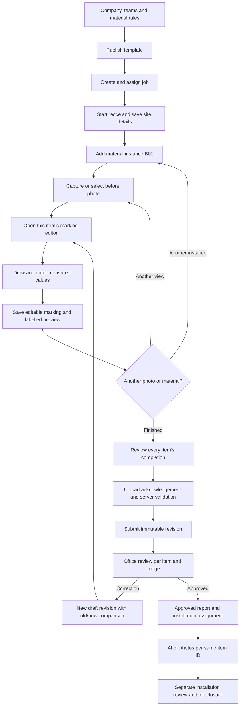

# RecceFlow full-flow implementation plan — Version 1.1

Prepared 24 October 2026. Based on the supplied Version 1.1 prototype brief, especially Section 9, the five UI references and the existing foundation implementation.

This document was a planning update on 24 October. **Implementation update, 26 October:** the sample-form field journey, private photo editor and locked submission are now working. Use the [field recce test guide](Field_Recce_Test_Guide.md) and [implementation status](Implementation_Status.md) for the current feature boundary. The full plan below remains the target; imported templates, correction/approval, reports, offline sync, installation and technical escalation are not yet complete. The earlier project's support requirements remain part of this plan.

The subsequent [camera/voice/panorama/chat update](Camera_Voice_Panorama_Chat_Guide.md) adds direct capture, recorded remarks, explicit area rules, shared-image overview, supplied 360° panorama tagging and company job discussion. It does not add in-app panorama stitching, pixel-to-physical measurement or platform technical escalation.

## Central product rule

Every material instance has its own identity, before-photo evidence, editable markings, structured measurements, marked-image previews and completion state. Material selection through an imported form enters this same flow. A material name in a text field or a job photo gallery does not complete the requirement.

The prototype requires before photos and marking for every item. A future exception must be explicitly configured in a published template, require a reason and be visible to the reviewer. Workers cannot switch evidence requirements off. Resolve and snapshot template/material rules into the revision so catalogue changes cannot alter past requirements.



## 1. Company onboarding and configuration

Administrator creates company settings, units, timezone, languages and support contacts; creates teams and grants; and configures the material catalogue. Material definitions use a measurement mode rather than assuming width × height for everything.

| Example | Measurement inputs | Evidence |
|---|---|---|
| ACP fascia / flex | Width, height, optional depth; quantity separately | Before photo plus shaped/freehand marking with named dimensions |
| Vinyl / window graphic | Width and height; declare bounding dimensions for irregular outlines | Polygon, rectangle or freehand marking; no invented irregular area |
| LED strip / cable | Measured length and unit | Line, route or freehand marking with a length label |
| Letters / fittings | Positive whole-number count; other dimensions only when configured | Outline, circles or arrows locating items and count label |
| Custom fabrication | Named sides, diameter, depth or configured measurements | Polygon/freehand/other shape with the corresponding named labels |

All material modes support shape and freehand tools. These are configurable demonstration defaults, not universal trade rules. Area calculations are allowed only for declared geometry; physical dimensions never come from photo pixels.

## 2. Form upload and published template

Upload a blank form → review extraction/manual fields → confirm types, units and repeating material sections → preview on mobile → publish a version. Keep the original private source. AI suggestions remain unapproved until reviewed; unconfigured extraction uses only the labelled sample fixture or manual entry.

Map each material-selecting field/repeating row to a MaterialInstance. Its card must expose photo and marking actions. Use stable field IDs and explicit mappings to prevent the same selection producing both an unlinked text answer and a duplicate item. Template changes create new versions; jobs pin the selected published version.

For development, start with a manually configured published sample template before building arbitrary form extraction. The final user journey still begins with company/template setup.

## 3. Job creation and assignment

Office selects project, site/contact, instructions, expected materials, published template, due date and workers. Choose one draft owner; preserve assignment/handover history. Expected materials are guidance; worker-added differences require a reason and review.

The current admin can create an unassigned job. Assignment and team management must be completed before treating the field flow as ready. Permissions apply to API routes, files, exports and live updates.

## 4. Worker starts recce

Jobs → job details → Start recce → save site location or recorded exception → short guided site questions → Materials & photos. Preserve progress when moving backwards or requesting help. Use five visible stages: Site, Details, Materials & photos, Remarks, Review.

No background tracking. Show location accuracy and any missing-location reason to office. Camera/microphone/location permission failures must offer a usable recovery path on trusted HTTPS.

## 5. Material cards and repeated materials

Each item card shows its code, material, placement, measured values, original/primary-marked thumbnails, number of marked views, completion state and next missing action.

Required actions:

- Add before photo.
- Mark image when no marking exists; Edit marking for a saved draft marking.
- View marked image and compare with original.
- Add another marked photo, with a view label such as Front view or Side detail.
- Choose primary marked photo for this item's card/report.
- Add same material or Add different material.

`Add same material` creates a new item ID and copies material/rule defaults only. Dimensions, drawings, completion, approval and photo links start empty. A worker may explicitly reuse a source image, then independently mark and confirm the new item. Do not silently copy measurements.

Different-sized pieces are different instances. Quantity > 1 represents intentionally identical pieces with the same specified size, never several independently measured boards hidden under one item.

Example job:

| Item | Material / placement | Values | Marking documents |
|---|---|---|---|
| B01 | ACP / front fascia | 12 ft × 3 ft | Front view + side detail |
| B02 | ACP / side board | 6 ft × 2.5 ft initially; corrected to 2 ft height | Its own front view |
| B03 | Vinyl / left window | Worker-entered width/height | Its own polygon/freehand view |
| B04 | LED strip / canopy edge | Worker-entered length | Its own route view |
| B05 | Letters / upper sign | Worker-entered count | Its own locating marks and count label |

## 6. Editor interaction and save contract

Keep `JOB-1042 · B02 · ACP · Side board · Front view` visible. Never open an unidentified canvas. Switching items/views with unsaved changes offers Save, Discard or Stay; navigation must not silently lose work.

Editor tools: select/move/resize, rectangle, ellipse, polygon, line/arrow, polyline and freehand; colours and stroke thickness; delete selected; undo/redo; zoom/pan and fit; explicit draw-versus-pan mode. Reset requires confirmation. Labels remain readable without depending only on colour.

Select a mark → enter the item's configured dimensions → confirm units → position dimension arrows/leader labels → preview original versus marked → save. Freehand routes can carry movable labels without forcing rectangular geometry. Count items show count, not fabricated length units. Optional voice-suggested values require explicit confirmation and are deferred until a real provider exists.

Store original entered values and canonical lengths separately. Feet-and-inches has separate controls; 5.6 decimal feet is not 5 ft 6 in. Required lengths are positive; count is a positive integer. Rounding/display rules are explicit.

Save an editable domain document, not just Konva scene JSON or a screenshot. Store normalized source coordinates, shape IDs, points/transforms/styles, label offsets and measurement references. Convert pointer coordinates through inverse canvas transforms. Normalize image orientation on ingestion and preserve source identity/dimensions/hash.

Each annotation document belongs to exactly one revision material item and one immutable source image. One source image may have many documents owned by different items. Never key editable state by material type or attachment alone.

Measurements are structured records; labels derive from them. A change invalidates every affected preview for that item, including alternate views. Tag generated previews with annotation version, source hash and measurement fingerprint. Reject a stale export finishing after a newer edit. If the source photo changes, require a new/re-marked document rather than applying old coordinates.

Persist the item, measurements, source link and annotation coherently; track preview upload/generation separately until acknowledged. Mark Saved to office only after server acknowledgement. Keep original images and derived previews distinct. Deleting a shape does not delete a shared source photo. Deleting an item's link cannot delete another item's evidence.

## 7. Item completion and final submission

Capture states are derived, not editable status switches: Photo needed, Marking needed, Measurements needed, Waiting to upload or Ready. Ready is separate from reviewer Approved. Show all missing actions on review, even if a card displays one next action.

For every included material item, the server checks:

1. Worker ownership/assignment and expected draft row version are valid; material/template rule snapshots are present.
2. Required before photos and source images are uploaded and available to this company/job.
3. Required marking documents contain real supported marks; an empty saved canvas fails.
4. Required mode-specific measurements are valid and worker-confirmed.
5. Shape, measurement and photo references belong to the same revision/item; source dimensions and coordinate ranges are valid.
6. Every included marked view has a current acknowledged preview and an unambiguous primary view; unfinished views are completed or explicitly removed from the draft.
7. Preview versions/fingerprints match the saved annotation and measurements; no required media remains queued or failed.
8. Required site/form answers and location exception policy pass.

Return actionable errors containing item/view/field IDs, such as `B02: add height` or `B04 · Route view: wait for image upload`. Focus the affected card. Offline Submit says Waiting to send, never Submitted. Retry with stable operation IDs. Commit the submission, audit and notification outbox atomically; lock the submitted revision and its evidence references.

## 8. Office review and correction

Queue → selected submitted revision → item list → selected item → original/marked comparison, every marked view, measurement table, remarks and location exceptions. Selecting a card opens that item's records, not the first job photograph. Primary view is a display choice; office can inspect every view.

Correction issues can identify revision, item, annotation document, shape and field. Example: Meera flags B02 height. Ravi opens a correction draft, sees 2.5 ft submitted versus the new value, enters 2 ft and regenerates all B02 views using that height. Preserve the earlier 2.5 ft markings and previews.

Cloning a revision retains stable item IDs but creates new revision-child IDs. Remap all measurement/shape references into the new revision; immutable source blobs may be reused. Never point a new draft label at an old revision's mutable measurement record.

Reviewer approves the new submitted revision with concurrency protection. Approval requires every required item/section approved or explicitly not applicable with a reason. Unresolved correction issues block approval. Messages and support responses never update measurements or approve evidence automatically.

## 9. Reports and installation

Exports select an immutable revision: latest approved by default, or explicitly selected historical revision. Include separate rows/sections per instance, readable units/labels and the primary plus additional marked views. Include original photo evidence. Show pending/draft status when appropriate; protect spreadsheet exports against formula execution.

Installation tasks pin the approved recce revision and stable item IDs. Installer sees agreed specifications read-only, adds after photos against B01/B02/etc., then submits installation separately. Office compares before, approved marked views and after evidence. Installation changes require an explicit office decision. Close only after required installation approval or an authorised recce-only closure reason.

## 10. Support throughout the flow

Need help? remains available on job details, material cards, editor, upload failure and final review. Prefill job, item, view and optional shape reference without losing the draft. Submit to the company office support team. A worker can send text and, once implemented, audio/images. Keep device-saved versus delivered states honest.

Office handles the request or escalates selected context to technical support. Deliberately share diagnostic details and attachments; technical staff do not gain unrestricted company access. Separate worker replies, company internal notes and technical internal notes. Preserve one office owner while technical investigation proceeds.

Contact us uses configured office/platform contacts only. Support resolution cannot mark an item Ready, waive evidence, approve a recce or modify an installation. Link a formal correction issue when a measurement needs changing. Refer to the original project plan for the full support permission/state model.

## 11. Data relationships and API additions

Extend the existing database through migrations; retain login, jobs, support tickets and current demo records. No destructive reset.

| Record | Planned responsibility |
|---|---|
| MaterialTypes | Configurable measurement mode, allowed units and default evidence rules |
| FormTemplateVersions | Published schema and evidence requirements; immutable |
| RecceRecords / RecceRevisions | Draft ownership, submission identity, pinned rules and concurrency |
| MaterialInstances | Stable job item ID and B01/B02 code across revisions |
| RecceMaterialItems | One instance's material/placement/quantity/rule snapshot in one revision |
| Measurements | Named entered values, unit, canonical length where applicable and confirmation; counts remain unitless integers |
| Attachments / ReccePhotoLinks | Private immutable source files and per-item evidence roles |
| AnnotationDocuments | Many per revision item; source attachment, view label/order, versioned editable document, source metadata and preview status |
| AnnotationMeasurementLinks | Validated references linking the document/shape to this same revision item's measurements |
| AnnotationPreviewVersions | Immutable derivative attachment plus annotation version/source/measurement fingerprint; stale generations cannot become current |
| RecceMaterialItems.PrimaryAnnotationDocumentId | Optional while drafting; required at readiness; must point to this same item's document |
| CorrectionIssues / ReviewDecisions | Exact revision, item, optional document/shape/field target and append-only decisions |
| SupportTickets and later support tables | Optional item/document/shape context with validated visibility |

Use company-aware foreign keys and ownership checks, not client-supplied CompanyId. Review existing one-document assumptions: no unique constraint may limit an item to one annotation document. Preview pointers refer to immutable derivative versions; submitted snapshots pin their exact versions. Material rule snapshots and completion blockers should be returned by server DTOs.

Proposed API additions, refined during implementation:

```text
POST /api/jobs/{jobId}/recce/start
GET  /api/recce-revisions/{revisionId}
POST /api/recce-revisions/{revisionId}/materials
PUT  /api/recce-material-items/{itemId}/measurements
POST /api/recce-material-items/{itemId}/photo-links
POST /api/recce-material-items/{itemId}/annotations
GET/PUT /api/annotations/{documentId}
POST /api/annotations/{documentId}/preview
PUT  /api/recce-material-items/{itemId}/primary-annotation
GET  /api/recce-revisions/{revisionId}/completion
POST /api/recce-revisions/{revisionId}/submit
```

Every draft mutation checks revision ownership/state and expected concurrency version. Use DTO validation, bounded uploads/annotation sizes, private authorised download endpoints and retry idempotency. Return conflict instead of overwriting newer work. Enforce document/item/revision consistency server-side even when URLs or payload IDs are altered.

## 12. Mobile, tablet and desktop UI

Mobile: four destinations Jobs, My recce, Messages, Profile; Support is reachable within Messages/Profile and contextual Need help?. The current Overview/Jobs/My recce/Support prototype navigation will evolve into these role-appropriate destinations as the remaining features are built.

Use full-screen canvas, persistent item/view title, bottom measurement sheet, 48 px or larger touch targets, large Save and Listen to help. Keep pan and drawing modes explicit. Preserve edits during keyboard opening, orientation change and help navigation. Support text and illustration alongside English/Hindi/Marathi audio guidance.

Tablet portrait follows mobile. Tablet landscape puts canvas beside material/measurement controls and permits item-specific correction discussion alongside evidence. Desktop uses company configuration, review queues, item/view selection, comparison and support panes. No worker needs to manage a dense office table on a phone.

## 13. Build order from the current application

| Delivery | Work | Completion gate |
|---|---|---|
| A. Finish foundation | Company/material rules, teams/grants, assignments, DTO organisation, job editing | Office creates and assigns a job; only assigned worker can start it |
| B. Revision and evidence model | Sample pinned template, drafts, material instances, measurements, private uploads, many documents/views | Same-material items and shared source images remain independent |
| C. Editor | Shapes/freehand, colours, touch controls, labelled dimensions, save/reopen, multi-view/primary selection | B01/B02/B03/B04/B05 open correct editors and retain aligned marks |
| D. Reliable submit | IndexedDB drafts, staged media, versioned previews, completion endpoint, immutable submission | Incomplete/stale/failed evidence blocks submission with item-specific recovery |
| E. Office and support | Review/correction cloning, replies/voice, support queue/escalation, audit, notifications, reports | Correct B02 without changing B01 or the old revision; selected approved report matches |
| F. Template import | Upload/extraction/manual review, instance mapping, uncertainty resolution/versioning | Imported material selections produce markable cards and pinned requirements |
| G. Installation and demo hardening | After evidence, separate approval, real-device/accessibility/failure checks, backups | End-to-end job closes only after the correct approvals |

Do not call Milestone 2 complete after shipping a single-image rectangle demo. All required tools, modes, per-item flows and multiple views belong to its acceptance gate. Build in small working increments, preserving existing records and tests.

## 14. Acceptance scenarios

1. B01 ACP 12 × 3 ft and B02 ACP 6 × 2 ft save/reload independently; editing B02 changes no B01 value, drawing or preview.
2. B03 vinyl supports its own boundary; B04 LED supports manually entered length; B05 count-based letters shows count without irrelevant width/height errors.
3. B01/B02/B03 reuse one source photo; deleting B02's draft shape or photo link leaves the others and original file intact.
4. B01 has front and side documents; both reopen; primary-view changes affect only B01's card/report selection.
5. Save on mobile and reopen on landscape tablet/desktop; source alignment and labels survive resizing, zoom, portrait images and EXIF rotation.
6. Empty markings, missing measurements, failed uploads and stale previews block submission with the correct item/view error.
7. A measurement edit while a preview export is in flight cannot publish an old preview as current.
8. B02 correction produces a new revision and remapped references; the old submitted image remains unchanged; report selects the approved revision.
9. An imported form material row produces a real instance/card with Mark image and Edit marking, not only text.
10. Cross-company/unassigned access, forged measurement links, stale draft writes and duplicate submit retries fail safely.
11. Opening Need help? from B02's side view preserves unsaved work and correctly links support context; technical replies cannot approve or alter the item.
12. Original/marked/after photos remain paired by stable item identity through installation and export.

Automate the data-isolation, unit/count validation, document ownership, preview race, immutability and submit-retry cases. Browser tests cover the multi-item editor and correction journeys. Real-device tests cover camera, microphone, GPS and touch; no simulated browser test should be reported as physical-device validation.

## Existing implementation versus this plan

Already working: local SQL persistence, login, responsive foundation, admin job creation, assigned-job listing and basic text support requests. Existing API/browser checks cover that foundation.

Since this plan was written, a sample-form guided recce, per-material editor, multiple marked views, private photos, concurrency and locked first submission have been implemented and tested. Remaining work includes configurable/imported templates, automatic offline recovery, correction revisions, office approval, reporting, installation and technical escalation. Use Implementation_Status.md for verified scope and tests rather than treating every feature in this plan as complete.
